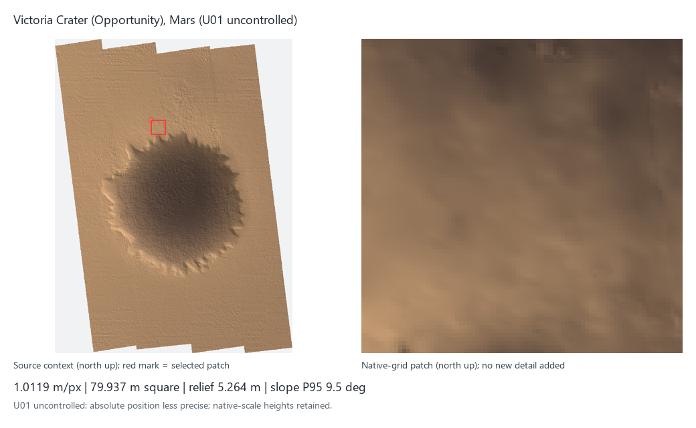
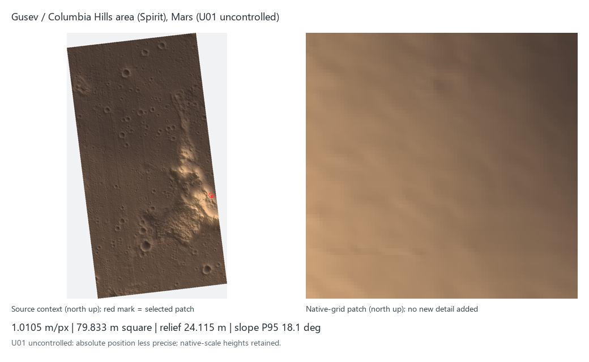
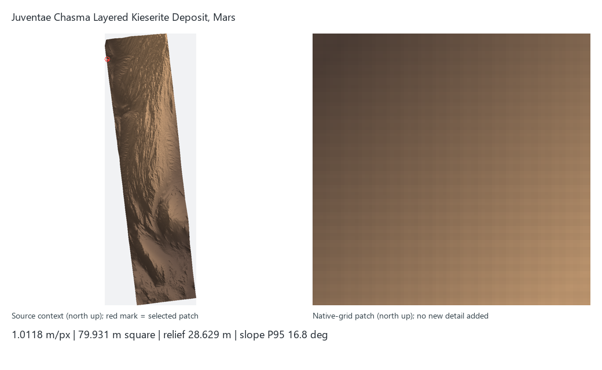
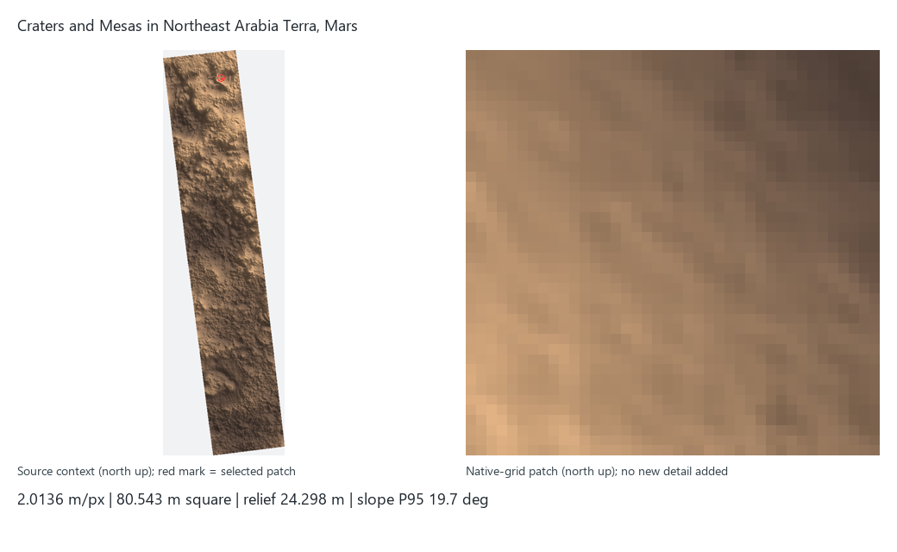
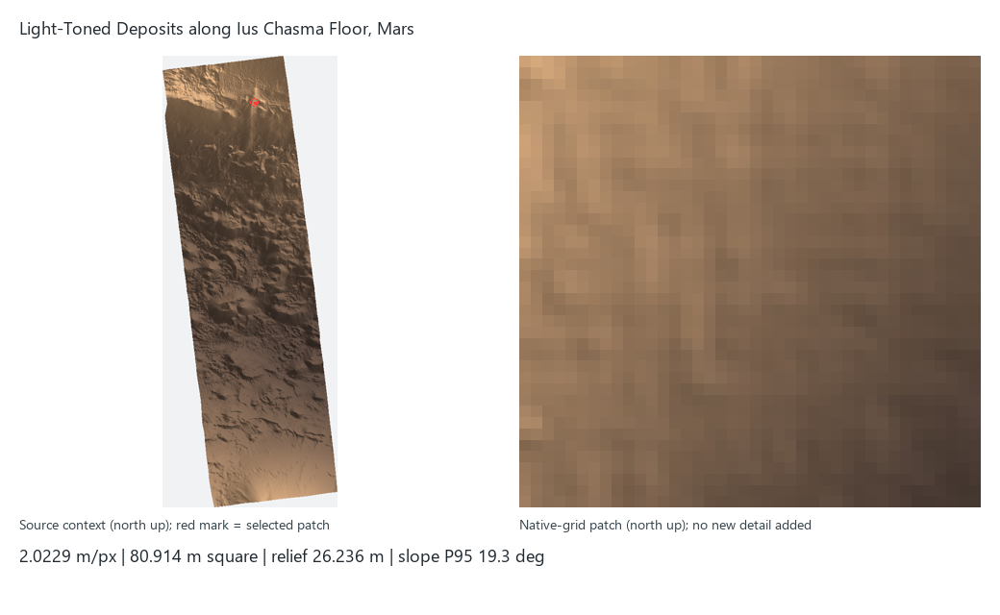
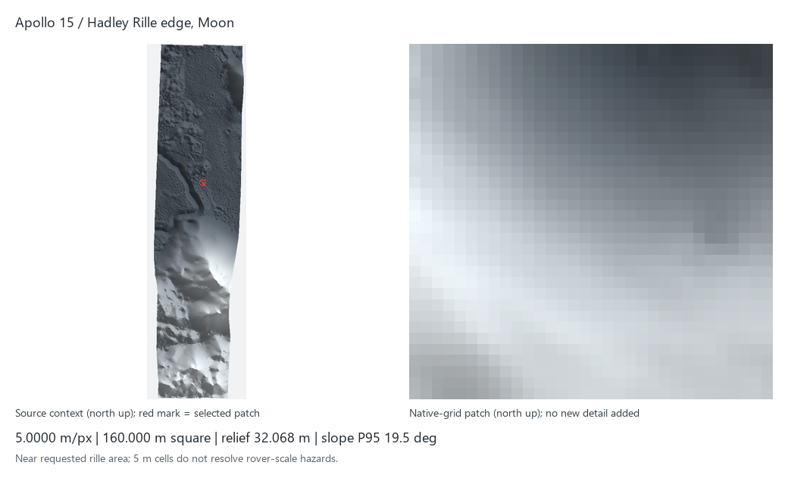
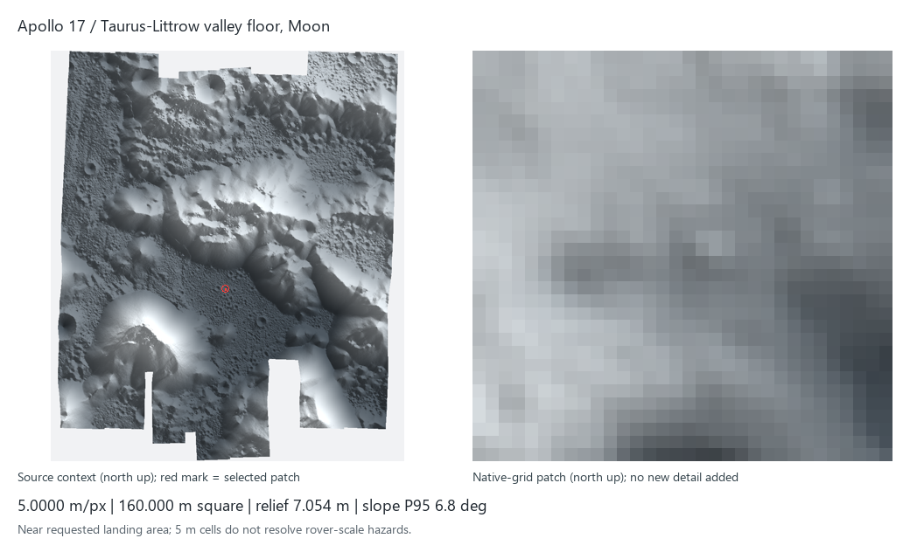
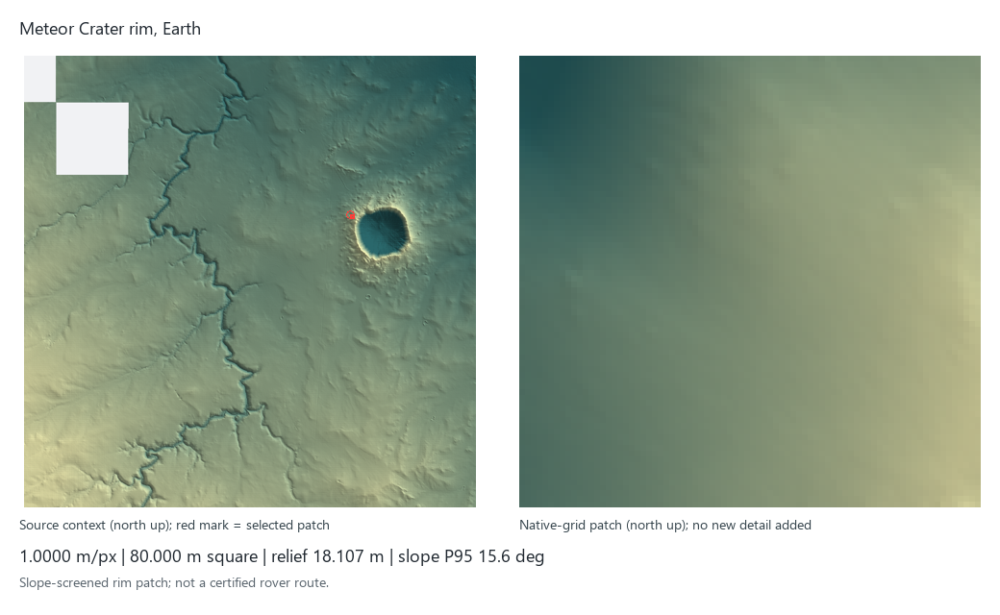
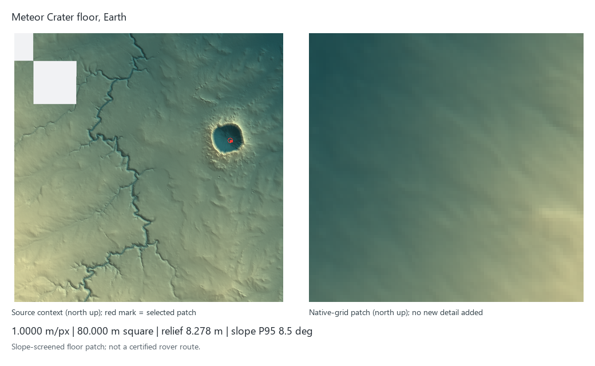

# Local terrain presets

Meteor Crater centre in EPSG:26912: E 497993.123, N 3876037.490; inside tile: True.

Slope screening: P95 <=20 deg, maximum <=30 deg; no route simulation.

| Preset / site | m/px | Patch m | Relief m | P95 slope deg | Preview |
|---|---:|---:|---:|---:|---|
| victoria-opportunity: Victoria Crater (Opportunity) | 1.0119 | 79.937 | 5.264 | 9.5 |  |
| gusev-columbia-hills: Gusev / Columbia Hills area (Spirit) | 1.0105 | 79.833 | 24.115 | 18.1 |  |
| juventae-kieserite: Juventae Chasma Layered Kieserite Deposit | 1.0118 | 79.931 | 28.629 | 16.8 |  |
| arabia-northeast-mesas: Craters and Mesas in Northeast Arabia Terra | 2.0136 | 80.543 | 24.298 | 19.7 |  |
| ius-chasma-floor: Light-Toned Deposits along Ius Chasma Floor | 2.0229 | 80.914 | 26.236 | 19.3 |  |
| apollo15-hadley-rille: Apollo 15 / Hadley Rille edge | 5.0000 | 160.000 | 32.068 | 19.5 |  |
| apollo17-taurus-littrow: Apollo 17 / Taurus-Littrow valley floor | 5.0000 | 160.000 | 7.054 | 6.8 |  |
| meteor-crater-rim: Meteor Crater rim | 1.0000 | 80.000 | 18.107 | 15.6 |  |
| meteor-crater-floor: Meteor Crater floor | 1.0000 | 80.000 | 8.278 | 8.5 |  |

## Lunar source validation

Apollo 15/17 elevation comes only from the attached-label PDS3 IMG DTMs: PC_REAL, 32-bit float, 5 m/pixel.
The IMAGE labels omit an explicit vertical UNIT and scale/offset. Metres follow the LROC NAC DTM/LOLA product convention;
the identity scale 1 and offset 0 are defaults verified against GDAL, not invented label entries.
CORE_NULL is 0xFF7FFFFB (~-3.402822655e38); other ISIS special pixels are excluded as no-data.
The supplied byte TIFFs remain local visual references and are never read as elevations.
Both 160 m lunar patches contain 32 x 32 native samples; orbital data does not resolve sub-5 m hazards.
